# 図解：ごはんくん（食事管理アプリ・PWA版）

| 項目 | 内容 |
|---|---|
| 版数 | 第1.1版 |
| 作成日 | 2026-11-14 |
| 元にした文書 | 要件定義書 第1.6版、基本設計書 第1.9版、デザイン仕様書 第1.5版 |
| 表示のしかた | VS Code の拡張機能「Markdown Preview Mermaid Support」を入れ、このファイルのプレビュー（`Ctrl+Shift+V`）を開く |

この文書は、要件定義書と基本設計書の内容を図にしたものです。図と仕様書の内容が食い違う場合は、**仕様書のほうが正しい**ものとします。仕様書を直したら、この図も直します。

| No | 図 | 主に元にした箇所 |
|---|---|---|
| 1 | 利用の流れ（1日の使い方） | 要件定義書 2章・3章 |
| 2 | 全体の構成 | 基本設計書 2.2 |
| 3 | プログラムの層 | 基本設計書 2.3 |
| 4 | 画面遷移 | 基本設計書 3.1、3.2 |
| 5 | 写真で記録する流れ | 基本設計書 5.12、5.15、6.3、6.4 |
| 6 | 食事の状態の移り変わり | 基本設計書 4.3、5.15 |
| 7 | AIのモデルの切り替え | 基本設計書 6.2、6.4 |
| 8 | 目標の計算 | 基本設計書 5.3、5.6 |
| 9 | 記録日の決め方 | 基本設計書 5.1 |
| 10 | アクティブエネルギーの取り込み | 基本設計書 6.5 |
| 11 | データの構成 | 基本設計書 4.2、4.3 |

---

## 1. 利用の流れ（1日の使い方）

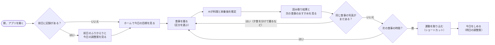

## 2. 全体の構成

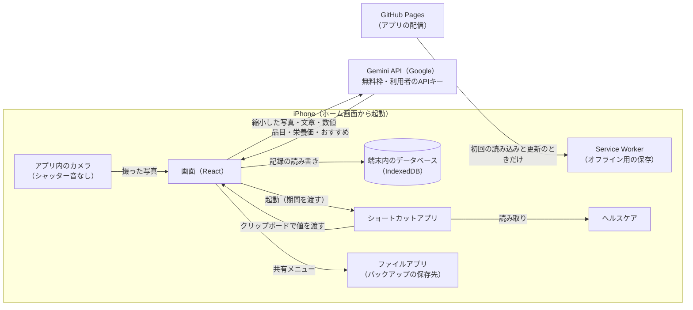

## 3. プログラムの層

矢印は「使ってよい向き」です。計算ロジック（domain）は、ほかのどの層にも依存しません。

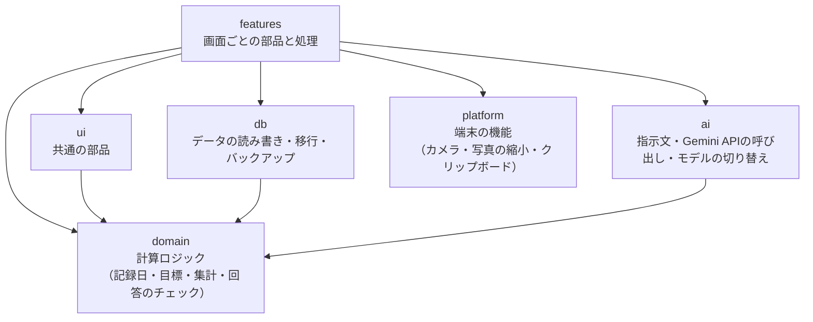

## 4. 画面遷移

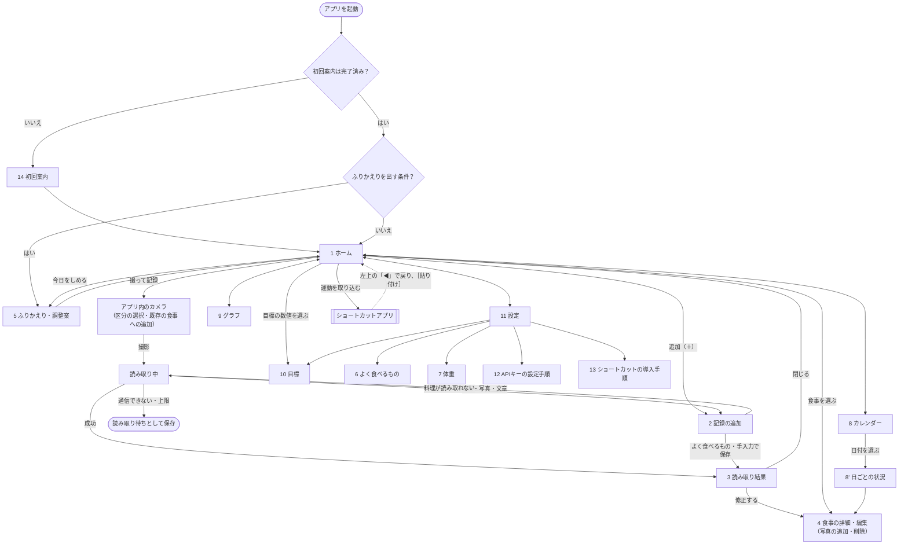

## 5. 写真で記録する流れ

同じ記録日・同じ区分の食事があれば、写真と品目をその食事にまとめます（F-REC-12）。写真はAIに送る前に保存するため、通信に失敗しても失われません。

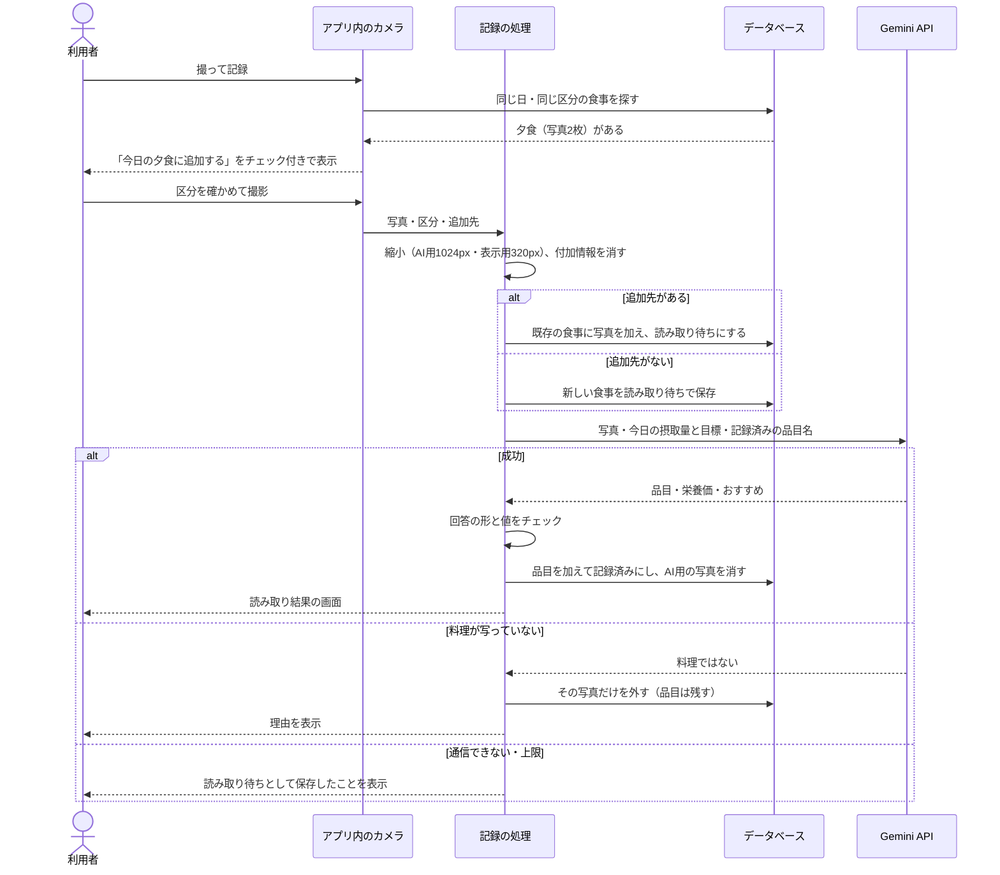

## 6. 食事の状態の移り変わり

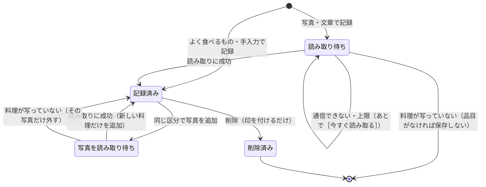

- 「写真を読み取り待ち」のあいだも、すでに記録した品目は今日の合計に含めます。

## 7. AIのモデルの切り替え

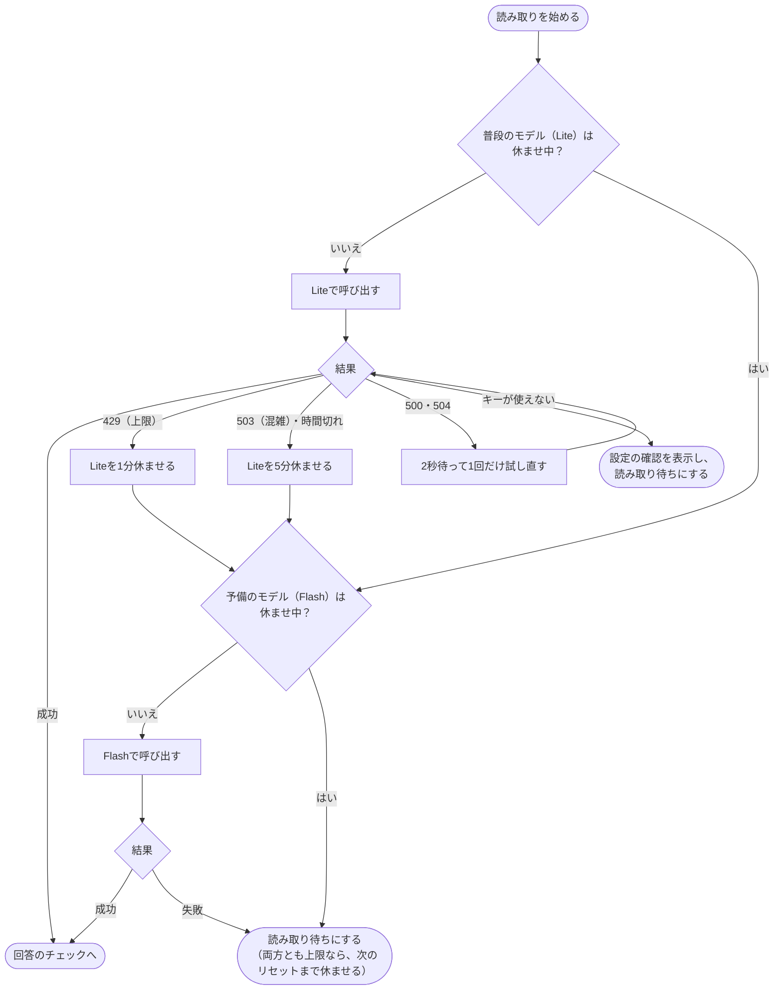

## 8. 目標の計算

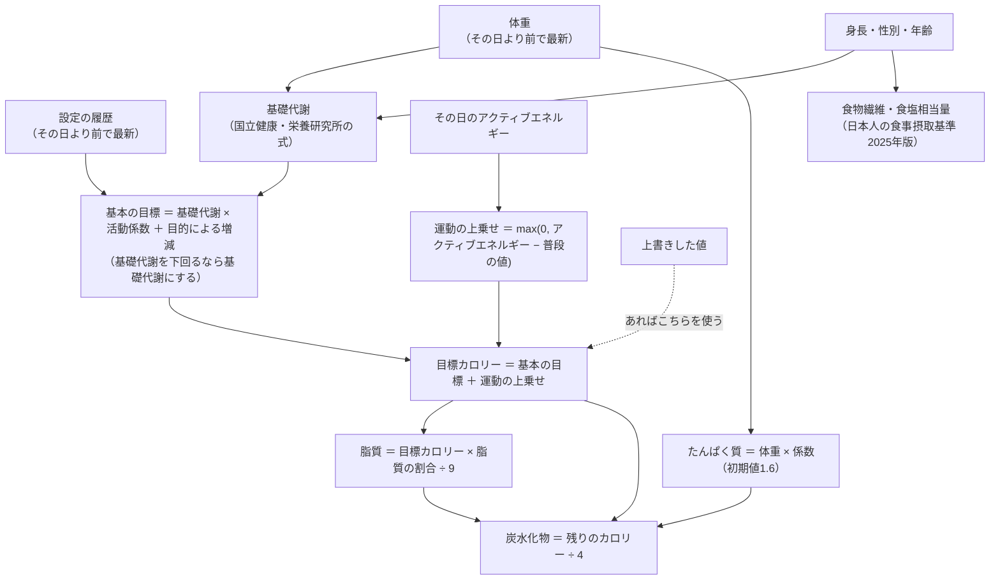

- 計算例：男性・35歳・172cm・70kg・活動係数1.50・減量 → 目標1,824kcal。アクティブエネルギー520kcalの日は2,044kcal。

## 9. 記録日の決め方

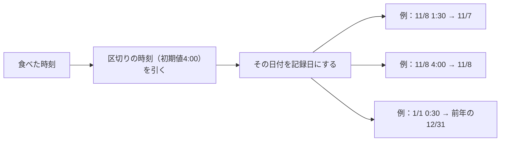

## 10. アクティブエネルギーの取り込み

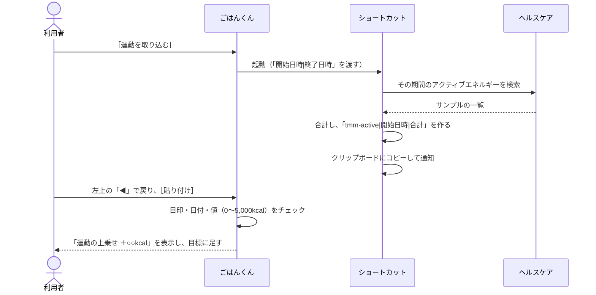

- うまくいかないときは、ホームの［手で入力］でアクティブエネルギーを入力できます。

## 11. データの構成

テーブル名と項目名は、プログラムの中の名前をそのまま書いています。

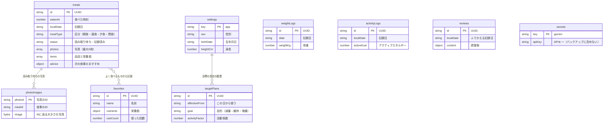

---

## 変更履歴

| 版数 | 日付 | 内容 |
|---|---|---|
| 1.0 | 2026-11-14 | 作成。要件定義書 第1.6版・基本設計書 第1.8版をもとに、11の図を作成 |
| 1.1 | 2026-11-14 | 基本設計書 2.2・3.2 の図を、この文書の図2・図4と同じ内容に更新したことに合わせ、元にした文書の版を更新 |
