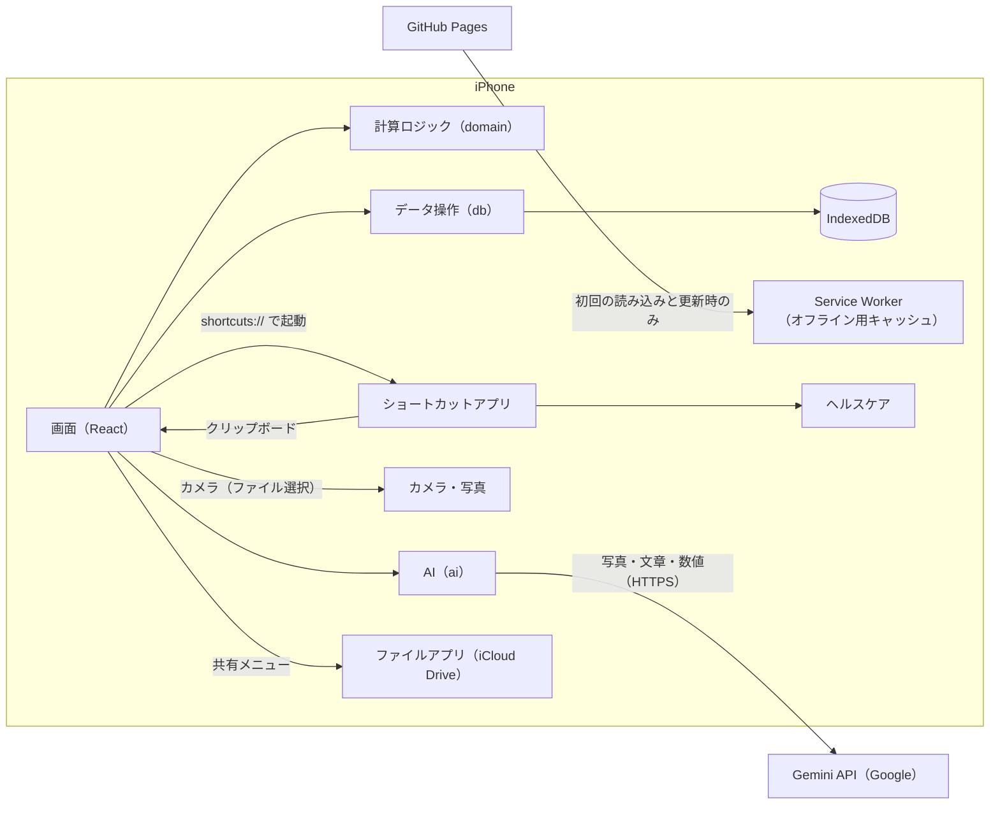
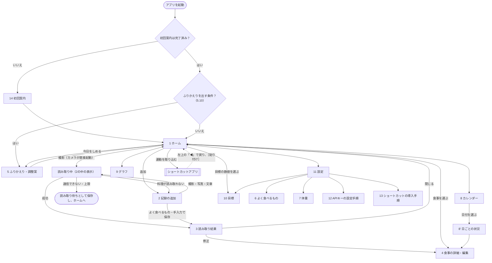

# 基本設計書：ごはんくん（食事管理アプリ・PWA版）

| 項目 | 内容 |
|---|---|
| 版数 | 第1.7版 |
| 作成日 | 2026-11-07 |
| 元にした文書 | 要件定義書 第1.5版（`仕様書/要件定義書.md`） |
| 次の工程 | デザイン仕様書（配色・部品・画面のレイアウト・アイコン）→ 実装 |

---

## 1. この文書の目的と範囲

要件定義書で決めた「何を作るか」を、「どう作るか」に落とし込みます。実装を始めるときに迷わないよう、次の内容を決めます。

| 章 | 内容 |
|---|---|
| 2 | 使う技術と、アプリ全体の構成 |
| 3 | 画面の一覧、画面遷移、各画面の項目、レイアウトの切り替え条件 |
| 4 | 保存するデータの形式、移行、バックアップファイル・CSVの形式 |
| 5 | 計算ロジック（記録日、目標、摂取量の集計、写真の縮小など） |
| 6 | 外部連携（Gemini API、ショートカット経由のヘルスケア） |
| 7 | PWAの設定、更新の流れ、公開（デプロイ）の流れ |
| 8 | 非機能要件をどう実現するか |
| 9 | 要件定義書の未決事項への回答と、残っている課題 |

色・文字サイズ・部品の見た目・アイコンは、デザイン仕様書で決めます。

---

## 2. システム構成

### 2.1 使う技術

版数は 2026-11-07 時点の最新版です（`npm view` で確認）。実装を始めるときに、もう一度最新版を確かめます。

| 分類 | 採用する技術 | 選んだ理由 |
|---|---|---|
| 言語 | TypeScript（6.0、Apache-2.0。training-appで動作の実績がある版） | 型チェックで、データ構造の間違いを実装中に見つけられる。AIの回答の形も型で決められる |
| 画面 | React（19.3、MIT）。関数コンポーネント＋Hooks | training-appと同じ。部品と情報が多く、実装が安定する |
| ビルド | Vite（8.3、MIT） | 起動と再読み込みが速い。PWAプラグインがある |
| PWA化 | vite-plugin-pwa（2.0、MIT） | マニフェストとService Workerを自動で生成できる |
| 画面の切り替え | React Router（8.5、MIT。training-appと同じ版）のハッシュ方式（`#/calendar` など） | GitHub Pagesでは、画面のURLを直接開いたり再読み込みしたりすると404になる。ハッシュ方式なら、この問題が起きない |
| データ保存 | IndexedDB＋Dexie.js（4.4、Apache-2.0）＋dexie-react-hooks（4.4、Apache-2.0） | IndexedDBを簡単に扱える。データが変わると画面が自動で更新される（`useLiveQuery`）。写真（Blob）もそのまま保存できる |
| AI | Gemini API（Interactions API）。ブラウザ標準の `fetch` で直接呼び出す（`src/ai/gemini.ts`）。`store: false`（やり取りをGoogleのサーバーに保存しない）を付ける | 実装の段階で公式の部品 `@google/genai` を調べた結果、次の理由で使わないことにした（2026-11-07 変更）。①失敗したときに自動でやり直す仕組みが、アプリ側のモデルの切り替え（6.4）と重なる。②初期設定では、やり取りがサーバーに保存される。③試験用ページで、`fetch` による呼び出しがPC・iPhoneで動くことを確認済み（6.1）。呼び出し方が変わった場合は、`src/ai/gemini.ts` だけを直す |
| グラフ | Chart.js（4.6、MIT）＋react-chartjs-2（5.3、MIT） | 折れ線・棒グラフを少ない設定で作れる。training-appと同じ |
| アイコン | Tabler Icons（`@tabler/icons-react` 3.50、MIT） | 食事・カメラなどの絵がそろっている。使うアイコンだけがアプリに組み込まれる |
| 日付の計算 | date-fns（4.4、MIT） | 日・週・月の区切りを、端末の時間帯で正しく計算できる |
| 見た目 | CSS Modules＋CSS変数 | 外部ライブラリを使わずに、ダークモードと画面幅による切り替えができる |
| テスト | Vitest（5.1、MIT）＋fake-indexeddb（6.2、Apache-2.0） | Viteと同じ設定で動く。fake-indexeddbで、データの移行もテストできる |
| 公開 | GitHub Pages＋GitHub Actions | 要件定義書 6章で決定済み |

- 一意のIDは、ブラウザ標準の `crypto.randomUUID()` で作ります。
- サーバー、外部の解析ツール、広告は使いません。外部への通信は、GitHub Pages（アプリの読み込みと更新の確認）とGemini APIだけです。
- 第三者の部品・素材のライセンス表示は `public/third-party-licenses.txt` にまとめ、設定画面の「このアプリについて」から開けるようにします。

### 2.2 全体の構成



### 2.3 プログラムの分け方

計算ロジックとAIの呼び出しを画面から分け、単体テストができるようにし、AIを差し替えられるようにします（要件定義書 5章 拡張性・保守性）。

| 層 | フォルダ | 役割 | 依存してよい先 |
|---|---|---|---|
| 画面 | `ui`、`features` | 画面の表示と操作の受け付け | 計算ロジック、データ操作、AI、端末機能 |
| 計算ロジック | `domain` | 記録日、目標、集計、AIの回答のチェックなど。**画面にもデータベースにもAIにも依存しない、普通の関数だけで作る**。現在時刻は引数で受け取る | なし |
| データ操作 | `db` | Dexieの定義、読み書き、データ形式の移行、バックアップと復元 | 計算ロジック |
| AI | `ai` | AIへの指示文（プロンプト）、回答の形の定義、Gemini APIの呼び出し、モデルの切り替え。ほかのAIに差し替えるときは、この層だけを変える | 計算ロジック（型とチェック） |
| 端末機能 | `platform` | 写真の縮小、ショートカットの起動、クリップボード、ファイルの共有、永続ストレージ、ホーム画面から起動しているかの判定 | なし |

**AI層の窓口**（画面からはこの2つの関数だけを使う）
| 関数 | 内容 | 関連する要件 |
|---|---|---|
| `analyzeMeal(入力, 状況)` | 写真または文章から品目と栄養価を推定し、同時に次の食事のおすすめを作る（6.3） | F-AI-01、F-ADV-01 |
| `writeAdvice(種類, 状況)` | 次の食事のおすすめ、前日のふりかえりと今日の調整案、明日の調整案を作る（6.3） | F-ADV-01〜03 |

---

## 3. 画面設計

### 3.1 画面一覧とURL

| No | 画面 | URL（`#` 以降） | 主な内容 |
|---|---|---|---|
| 1 | ホーム | `/` | 今日の状況、撮影ボタン、今日の食事、次の食事のおすすめ、お知らせ |
| 2 | 記録の追加 | `/meal/new` | 撮影・写真・文章・よく食べるもの・手入力の切り替え、区分と日時 |
| 3 | 読み取り結果 | `/meal/:id/result` | 推定した品目と栄養価、おすすめ、修正への入り口 |
| 4 | 食事の詳細・編集 | `/meal/:id` | 写真、品目の追加・削除・量の変更、区分と日時、削除、保存したおすすめ |
| 5 | ふりかえり・調整案 | `/review/:date` | 指定した記録日の目標との差と、AIの調整案 |
| 6 | よく食べるもの | `/favorites` | 一覧・検索・追加・編集・削除 |
| 6' | よく食べるものの編集 | `/favorites/:id` | 名前・量・単位・栄養価 |
| 7 | 体重 | `/weight` | 体重の記録・一覧 |
| 8 | カレンダー | `/calendar` | 月表示、日付ごとの状況 |
| 8' | 日ごとの状況 | `/day/:date` | ホームの「今日の状況」と同じ内容を、指定した記録日で表示する（F-DAY-04） |
| 9 | グラフ | `/stats` | 週・月・年の切り替え、各指標 |
| 10 | 目標 | `/target` | 今日の目標と計算の内訳、目標の設定、上書き |
| 11 | 設定・プロフィール | `/settings` | プロフィール、AI、ヘルスケア連携、記録日の区切り、データ |
| 12 | APIキーの設定手順 | `/settings/api-key` | キーの発行手順、利用制限の設定方法、AIに送る内容とデータの扱い |
| 13 | ショートカットの導入手順 | `/settings/shortcut` | ショートカットの作り方、動作確認 |
| 14 | 初回案内 | `/welcome` | ホーム画面への追加、プロフィール、APIキー、バックアップの説明 |

- 画面下部のタブ（iPhone）と左側のメニュー（iPad・PC）には、「ホーム」「カレンダー」「グラフ」「設定」の4つを置きます。
- 記録の追加・読み取り結果・編集の画面では、タブとメニューを隠し、操作に集中できるようにします。

### 3.2 画面遷移図



### 3.3 各画面の項目

#### 1. ホーム
上から次の順に表示します。お知らせは、出す条件を満たしたものだけを表示します。

| 順 | 部品 | 内容 | 関連する要件 |
|---|---|---|---|
| 1 | お知らせ：更新 | 「新しい版があります［更新する］」 | 非機能・更新 |
| 2 | お知らせ：読み取り待ち | 「読み取り待ちの写真が◯件あります［今すぐ読み取る］」（通信が戻ったときも表示する） | F-AI-08 |
| 3 | お知らせ：APIキー | キーが未設定のとき「AIを使うにはAPIキーの設定が必要です［設定する］」 | F-KEY-04 |
| 4 | お知らせ：体重 | 「最後の体重の記録から7日たちました［記録する］」 | F-WGT-02 |
| 5 | お知らせ：バックアップ | 「最後のバックアップから7日たちました［今すぐバックアップ］」 | F-DATA-05 |
| 6 | 今日の状況 | 記録日（例：「11月7日（金）」）。カロリーを大きく「摂取 1,250 ／ 目標 1,824 kcal（あと574）」。その下に、PFC・食物繊維・食塩相当量を、摂取・目標・状態（5.5）で並べる。押すと目標の画面へ | F-DAY-01、02 |
| 7 | 撮影ボタン | 大きなボタン。押すとすぐにカメラが起動する（5.12）。横に［追加］（記録の追加画面へ） | F-REC-01、非機能・使いやすさ |
| 8 | 運動 | 連携がオンのとき「運動の上乗せ：＋220kcal（アクティブエネルギー520kcal）」［運動を取り込む］。取り込み後に戻ったときは［貼り付け］を表示する（6.5） | F-HLT-01 |
| 9 | 次の食事のおすすめ | 最後に保存したおすすめ（6.3）。おすすめがないときや、AIが使えないときは、数値による不足・超過の一覧だけを表示する | F-ADV-01、05 |
| 10 | 今日の食事 | 区分（朝食・昼食・夕食・間食）ごとに、縮小した写真・品目名・カロリー。読み取り待ちの食事には印を付ける。押すと食事の詳細へ | F-DAY-03 |
| 11 | 今日をしめる | ［今日をしめる］。押すと、明日の調整案を作って、ふりかえりの画面に移る | F-ADV-03 |

撮影ボタンは、最初の画面内に必ず表示します（2タップで記録を始められるようにするため。要件定義書 5章）。

#### 2. 記録の追加
| 項目 | 内容 | 関連する要件 |
|---|---|---|
| 記録の方法 | ［撮影］［写真を選ぶ］［文章で入力］［よく食べるもの］［手入力］の5つ。初期表示は、よく食べるものの一覧 | F-REC-01〜05 |
| 区分 | ［朝食］［昼食］［夕食］［間食］。初期値は時刻から決める（5.2） | F-REC-06 |
| 日時 | 初期値は今の日時。変更できる（未来の日時は選べない） | F-REC-07 |
| 文章で入力 | 複数行の入力欄（最大200文字）と［読み取る］ | F-REC-03 |
| よく食べるもの | 使った回数の多い順。上に検索欄。押すと、量を確認する欄（初期値は登録した量）が開き、［追加］で品目に加える | F-FAV-03、04 |
| 手入力 | 名前（必須、40文字まで）、量と単位、カロリー（必須）、たんぱく質・脂質・炭水化物・食物繊維・食塩相当量（任意。空欄は0として扱う） | F-REC-05 |
| 追加した品目 | よく食べるもの・手入力で加えた品目の一覧と合計。各品目に［×］ | F-REC-09 |
| ［保存］ | 品目が1つ以上あると押せる。保存したら、おすすめを作り（6.3）、読み取り結果の画面に移る | F-ADV-01 |
| 読み取り中 | 撮影・写真・文章で［読み取る］を押すと、「読み取っています…」と経過秒数を表示する。30秒で中断する（6.4）。［中止］で読み取りをやめる（写真は読み取り待ちとして残す） | 非機能・性能 |

- 撮影・写真・文章で読み取った結果は、確認を挟まずに保存します（F-AI-02）。よく食べるもの・手入力の品目を先に追加していた場合は、同じ食事にまとめて保存します（F-REC-09）。
- 読み取りに失敗した場合の動きは6.4のとおりです。

#### 3. 読み取り結果
| 項目 | 内容 | 関連する要件 |
|---|---|---|
| 写真 | 縮小した写真（文章で記録した場合は、入力した文章） | ― |
| 品目 | 名前・量・カロリー・PFC。品目ごとに［よく食べるものに登録］ | F-AI-01、F-FAV-01 |
| 合計 | この食事の栄養価6項目の合計 | ― |
| 注意書き | 「AIによる推定値です。写真だけでは量の推定がずれやすいため、違っていたら修正してください」 | F-AI-09 |
| 今日の状況 | この食事を含めた、今日の摂取・目標・残り | F-DAY-01 |
| 次の食事のおすすめ | AIの文章（6.3）。「一般的な目安であり、医療的な助言ではありません」 | F-ADV-01、08 |
| 操作 | ［修正する］（食事の詳細・編集へ）［閉じる］（ホームへ） | F-REC-08 |

#### 4. 食事の詳細・編集
| 項目 | 内容 |
|---|---|
| 写真 | 縮小した写真。押すと大きく表示する |
| 区分・日時 | 変更できる。日時を変えると記録日も計算し直す（5.1） |
| 品目 | 名前・量・栄養価を編集できる。量を変えると栄養価を同じ割合で計算し直す（5.7）。［品目を追加］で、記録の追加画面と同じ方法で品目を足せる |
| 保存したおすすめ | この食事のときに作ったおすすめ（F-ADV-06）。［おすすめを作り直す］（品目を直したあとで、最新の内容で作り直す） |
| 読み取り待ち | 読み取り待ちの食事では［今すぐ読み取る］を表示する |
| 削除 | 確認してから、「削除済み」の印を付ける（4.1） |

#### 5. ふりかえり・調整案
| 項目 | 内容 | 関連する要件 |
|---|---|---|
| 対象の記録日 | 例：「11月6日（木）のふりかえり」 | F-ADV-02 |
| 目標との差 | 栄養価6項目の摂取・目標・差・状態（5.5） | F-ADV-02 |
| AIの調整案 | 「今日の調整案」（ふりかえりから来た場合）、または「明日の調整案」（今日をしめるから来た場合） | F-ADV-02、03 |
| AIが使えないとき | 目標との差だけを表示し、「AIが使えないため、数値だけを表示しています」と書く | F-ADV-05 |

#### 6. よく食べるもの（6' 編集も共通）
| 項目 | 内容 | チェック |
|---|---|---|
| 一覧 | 使った回数の多い順。検索欄 | ― |
| 名前 | 文字 | 必須、40文字まで |
| 量・単位 | 数値と単位（g、ml、杯、個、枚、本、皿、人前、そのほか自由入力） | 量は0より大きい |
| 栄養価 | 6項目。カロリーは必須、ほかは空欄なら0 | 0以上、5.8の上限以下 |
| 削除 | 確認してから削除済みの印を付ける。過去の記録は変わらない（F-FAV-02） | ― |

#### 7. 体重
| 項目 | 内容 | チェック |
|---|---|---|
| 入力 | 日付（初期値：今日の記録日）と体重 | 20〜300kg、0.1kg単位 |
| 一覧 | 新しい順。編集・削除 | ― |

- 同じ日付に入力したら、その日の1件を上書きします（F-WGT-01）。

#### 8. カレンダー
| 項目 | 内容 |
|---|---|
| 月の切り替え | ［＜］［＞］、［今日］ |
| 日付の印 | 記録のある日に、カロリーの状態（範囲内・不足・超過。5.5）で印の種類を変える |
| 日付を選んだとき | 日ごとの状況（8'）へ移る |

#### 9. グラフ
| 項目 | 内容 |
|---|---|
| 期間 | ［週］［月］［年］の切り替えと、前後の期間への移動。週は月曜始まり |
| 摂取カロリーと目標 | 摂取カロリーをマーカー付きの折れ線（データラベル付き）、目標カロリーを破線で重ねる（週・月は日ごと、年は月ごとの1日あたりの平均。見た目はデザイン仕様書 7.5） |
| PFC | たんぱく質・脂質・炭水化物の摂取量（g）を積み上げ棒で表示する |
| 体重 | 折れ線グラフ |
| 食物繊維・食塩相当量 | 折れ線グラフと目標の線（Should） |
| 期間のまとめ | 1日あたりの平均（カロリー・PFC）、カロリーが範囲内だった日数／記録した日数（Should） |

#### 10. 目標
| 項目 | 内容 | 関連する要件 |
|---|---|---|
| 今日の目標 | 栄養価6項目の目標 | F-TGT-01 |
| 計算の内訳 | 基礎代謝（年齢・身長・体重・性別）、活動係数、目的による増減、運動の上乗せ、下限を適用したか | F-TGT-04 |
| 目標の設定 | 目的（減量・維持・増量）、活動係数、目的による増減のkcal（−1,000〜＋1,000）、たんぱく質の係数（0.8〜2.5g/kg）、脂質の割合（15〜40%）、普段のアクティブエネルギー（0〜1,500kcal） | F-SET-02 |
| 上書き | 項目ごとに「自分で決めた値を使う」をオンにして値を入れる | F-TGT-03 |

- 目標の設定を変えたら、**変えた日の記録日から**新しい設定を使います。過去の日の目標は変わりません（4.3 `targetPlans`）。
- 注意書き「一般的な目安であり、医療的な助言ではありません」（F-TGT-05）。

#### 11. 設定・プロフィール
| グループ | 項目 |
|---|---|
| プロフィール | ニックネーム（任意）、性別、生年月日、身長（100〜250cm、0.1cm単位）。体重は体重の画面へ |
| 目標 | 目標の画面（10）へ |
| 記録 | 記録日の区切りの時刻（0:00〜6:00、1時間単位）、食事の区分の区切り時刻、よく食べるもの（6）へ |
| AI | APIキー（伏せ字で表示、［変更］［削除］［確認］）、使うモデル（6.2）、提案の好み（苦手な食材・外食が多いか。Could）、AIに送る内容とデータの扱い（12）へ |
| ヘルスケア連携 | オン・オフ、ショートカットの名前、導入手順（13）へ |
| データ | バックアップの書き出し、復元、CSVの書き出し、最後にバックアップした日時、バックアップを促すまでの日数（1〜30日）、体重の記録を促すまでの日数（1〜30日）、永続ストレージの状態 |
| アプリについて | 版数、ライセンス表示、「推定値であり医療的な助言ではありません」という注意書き |

#### 12. APIキーの設定手順
1. Google AI Studio（https://aistudio.google.com/ ）にGoogleアカウントでログインする
2. 「APIキー」の画面でキーを作る
3. キーの利用制限で「Gemini API だけに使える」制限を付ける（Googleの推奨。6.1）
4. キーをコピーし、このアプリの設定に貼り付けて［確認］を押す
5. 注意：無料枠で送った写真や文章は、Googleのサービスの改善に使われ、人が内容を読む場合があること。名前などは送らないこと（要件定義書 7.1）
6. 1日の回数の上限は、Google AI Studio の「Rate limit」の画面で確かめられること

#### 14. 初回案内
1. Safariのタブで開いている場合（5.13）：ホーム画面に追加する手順を案内し、「ホーム画面から開き直してください」と表示する。ここから先へは進めない（データの保存場所が別になるため）
2. 18歳以上であることの確認（Gemini APIの利用条件。6.1）
3. プロフィール（性別・生年月日・身長・体重）と目的（減量・維持・増量）を入力する
4. APIキーを設定する（［あとで］も選べる。あとで設定する場合は、AIを使わない記録だけが使える）
5. AIに送る内容とデータの扱いを説明する
6. データは端末内にしかないこと、定期的にバックアップが必要なことを説明する
7. 永続ストレージを要求する（7.4）。完了したらホームへ移る

PCのブラウザ（Chrome・Edge）では、開発中の確認のため、手順1を飛ばせるようにします。

### 3.4 レイアウトの切り替え条件
training-appと同じ条件です。

| 名称 | 条件 | レイアウト |
|---|---|---|
| コンパクト | 幅768px未満、**または高さ600px未満** | 1列表示、画面下部にタブ |
| ワイド | 幅768px以上、かつ高さ600px以上 | 左側にメニュー。ホームは「今日の状況・おすすめ」と「今日の食事」の2列表示。中身の最大幅は1200px |

```css
/* ワイドのときだけ適用する */
@media (min-width: 768px) and (min-height: 600px) { ... }
```

- 横向きのiPhoneはコンパクトになり、縦向きと同じ下部タブのまま表示されます。
- ノッチとホームバーに表示が重ならないよう、`env(safe-area-inset-*)` で余白を取ります。

---

## 4. データ設計

### 4.1 共通のルール

| 項目 | ルール |
|---|---|
| データベース名 | `tmm-meals`（このアプリ専用の接頭辞 `tmm-`（Track my mealsの略）。同じドメインのtraining-app（`dat-`）などと衝突させないため。要件定義書 7.1） |
| localStorage | 使わない（すべてIndexedDBに保存する） |
| 時刻 | エポックミリ秒（数値）で保存する |
| 記録日 | `YYYY-MM-DD` の文字列。区切りの時刻（初期値4:00）を考慮した日付（5.1）。検索のために保存し、区切りの時刻を変えたら全件を計算し直す |
| 栄養価 | 端数を残した数値で保存し、表示するときに丸める（5.4）。量を変えて計算し直したときに、誤差がたまらないようにするため |
| 共通の項目 | 次の表の項目を、記録・よく食べるものなど同期の対象になるデータすべてに持たせる（F-DATA-08） |

| 共通の項目 | 型 | 内容 |
|---|---|---|
| `id` | 文字列 | UUID |
| `createdAt` | 数値 | 作成した時刻 |
| `updatedAt` | 数値 | 最後に変更した時刻 |
| `deleted` | 0 または 1 | 削除済みの印。IndexedDBの索引は真偽値に対応していないため、0と1にする |

### 4.2 テーブル一覧

| テーブル | 内容 | 主な索引 |
|---|---|---|
| `meals` | 食事の記録（1回の食事が1件。品目は中に持つ） | `localDate`、`eatenAt`、`status`、`deleted` |
| `mealImages` | 読み取り待ちの写真（AIに送る大きさのもの） | `mealId` |
| `favorites` | よく食べるもの | `useCount`、`deleted` |
| `weightLogs` | 体重の記録 | `date` |
| `activityLogs` | 記録日ごとのアクティブエネルギー | `localDate` |
| `reviews` | ふりかえり・調整案 | `localDate` |
| `targetPlans` | 目標の設定の履歴（いつから、どの設定か） | `effectiveFrom` |
| `settings` | 設定とプロフィール（1件だけ。キーは `app`） | ― |
| `secrets` | APIキー（1件だけ。キーは `gemini`）。**バックアップに含めない** | ― |
| `meta` | 管理用の値 | ― |

### 4.3 各テーブルの項目

#### meals（食事の記録）
| 項目 | 型 | 内容 |
|---|---|---|
| （共通の項目） | | |
| `eatenAt` | 数値 | 食べた時刻 |
| `localDate` | 文字列 | 記録日（5.1）。保存・編集のたびに計算し直す |
| `mealType` | `breakfast` / `lunch` / `dinner` / `snack` | 区分 |
| `status` | `pending` / `done` | `pending`：読み取り待ち（品目はまだない）。`done`：記録済み |
| `inputText` | 文字列 または null | 文章で記録したときの入力 |
| `thumbnail` | Blob または null | 縮小した写真（長い辺320px、JPEG。5.12） |
| `items` | 配列 | 品目（下の表） |
| `advice` | オブジェクト または null | この食事のときに作ったおすすめ（`{ text, content, model, createdAt }`。F-ADV-06）。`content` は整理したおすすめ（6.3）、`text` はそれを文章にしたもの。2026-11-08 より前の記録には `content` がなく、`text` を表示する |

**items の1要素（品目）**
| 項目 | 型 | 内容 |
|---|---|---|
| `id` | 文字列 | UUID（品目の並べ替えや編集に使う） |
| `name` | 文字列 | 名前（例：「白ごはん」） |
| `amount` | 数値 | 量（例：150） |
| `unit` | 文字列 | 単位（例：「g」「杯」） |
| `nutrients` | オブジェクト | 栄養価：`{ kcal, protein, fat, carbs, fiber, salt }`（g。食塩は食塩相当量のg） |
| `source` | `photo` / `text` / `favorite` / `manual` | どの方法で記録したか |
| `favoriteId` | 文字列 または null | よく食べるものから記録した場合のID（使った回数の集計用） |
| `model` | 文字列 または null | AIで推定した場合のモデル名 |

#### mealImages（読み取り待ちの写真）
| 項目 | 型 | 内容 |
|---|---|---|
| `mealId` | 文字列（主キー） | 対象の食事 |
| `image` | Blob | AIに送る大きさの写真（長い辺1024px、JPEG。5.12） |

- 読み取りに成功したら、同じトランザクションの中で、この行を消し、`meals` の `status` を `done` にします（F-AI-05：元の大きさの写真は残さない）。
- 同期の対象にしない一時的なデータなので、共通の項目は持たせません。バックアップには含めます（読み取り待ちの写真を失わないため）。

#### favorites（よく食べるもの）
| 項目 | 型 | 内容 |
|---|---|---|
| （共通の項目） | | |
| `name`、`amount`、`unit`、`nutrients` | | 品目と同じ |
| `useCount` | 数値 | 記録で使った回数（並び順に使う） |
| `lastUsedAt` | 数値 または null | 最後に使った時刻 |

#### weightLogs（体重の記録）
| 項目 | 型 | 内容 |
|---|---|---|
| （共通の項目） | | |
| `date` | 文字列 | 記録日（`YYYY-MM-DD`）。同じ日付は1件だけ（上書き） |
| `weightKg` | 数値 | 体重（0.1kg単位） |

#### activityLogs（アクティブエネルギー）
| 項目 | 型 | 内容 |
|---|---|---|
| （共通の項目） | | |
| `localDate` | 文字列 | 記録日。同じ記録日は1件だけ（上書き。F-HLT-01） |
| `activeKcal` | 数値 | アクティブエネルギー（kcal、整数） |
| `source` | `shortcut` / `manual` | 取り込んだか、手で入力したか |

#### reviews（ふりかえり・調整案）
| 項目 | 型 | 内容 |
|---|---|---|
| （共通の項目） | | |
| `localDate` | 文字列 | ふりかえりの対象の記録日 |
| `kind` | `nextDay` | 翌日への調整案（ふりかえりから作った場合も、今日をしめるから作った場合も同じ） |
| `text` | 文字列 | 調整案を文章にしたもの |
| `content` | オブジェクト | 整理した調整案（6.3。2026-11-08 追加。古い記録にはない） |
| `model` | 文字列 | 使ったモデル |

#### targetPlans（目標の設定の履歴）
| 項目 | 型 | 内容 |
|---|---|---|
| （共通の項目） | | |
| `effectiveFrom` | 文字列 | この設定を使い始める記録日 |
| `goal` | `lose` / `keep` / `gain` | 目的 |
| `activityFactor` | 数値 | 活動係数（1.50、1.75、2.00） |
| `goalAdjustKcal` | 数値 | 目的による増減（初期値：減量−500、維持0、増量＋300） |
| `proteinPerKg` | 数値 | たんぱく質の係数（初期値1.6） |
| `fatRatio` | 数値 | 脂質の割合（初期値0.25） |
| `typicalActiveKcal` | 数値 | 普段のアクティブエネルギー（初期値300） |
| `overrides` | オブジェクト | 自分で決めた目標。`{ kcal, protein, fat, carbs, fiber, salt }` の各値は数値またはnull（nullなら計算した値を使う） |

- 記録日Dの目標は、`effectiveFrom` がD以前で最も新しい行の設定で計算します（5.3）。
- 同じ記録日のうちに何度設定を変えても、その日の行を上書きします（行は増やさない）。

#### settings（設定。キー `app` の1件だけ）
| 項目 | 型 | 初期値 |
|---|---|---|
| `nickname` | 文字列 | 空（AIには送らない） |
| `sex` | `male` / `female` | 初回案内で入力 |
| `birthDate` | 文字列（`YYYY-MM-DD`） | 初回案内で入力 |
| `heightCm` | 数値 | 初回案内で入力 |
| `dayBoundaryHour` | 数値 | 4 |
| `mealTypeStarts` | `{ breakfast, lunch, snack, dinner }`（各 `HH:mm`） | `{ breakfast: "04:00", lunch: "11:00", snack: "15:00", dinner: "17:00" }` |
| `primaryModel` | 文字列 | `gemini-3.5-flash-lite` |
| `fallbackModel` | 文字列 または null | `gemini-3.8-flash` |
| `advicePreferences` | 文字列 | 空（苦手な食材など。F-ADV-07、Could） |
| `healthEnabled` | 真偽値 | true |
| `shortcutName` | 文字列 | `ごはんくんにアクティブエネルギーを渡す`（6.5） |
| `backupReminderDays` | 数値 | 7 |
| `weightReminderDays` | 数値 | 7 |
| `onboardingDone` | 真偽値 | false |
| `updatedAt` | 数値 | ― |

#### secrets（キー `gemini` の1件だけ）
| 項目 | 型 | 内容 |
|---|---|---|
| `apiKey` | 文字列 | Gemini APIのキー |
| `verifiedAt` | 数値 または null | 最後に［確認］で使えることを確かめた時刻 |

#### meta（管理用の値）
| キー | 内容 |
|---|---|
| `schemaVersion` | データ形式の版（最初は1） |
| `firstLaunchAt` | 初回起動の時刻 |
| `lastBackupAt` | 最後にバックアップを書き出した時刻 |
| `lastReviewCheckedDate` | ふりかえりを出すかを最後に判定した記録日（5.10） |
| `modelCooldown` | 上限に達したモデルと、使わない期限（`{ [モデル名]: 時刻 }`。6.4） |

### 4.4 データ形式の移行
- Dexieの版管理（`db.version(n).upgrade(...)`）で、データ形式を変えたときに、既存のデータを自動で新しい形式に直します。
- 移行の処理は `domain/migration.ts` に置き、端末内のデータベースと、古い版のバックアップファイルの復元の両方で使います。移行には必ず単体テストを書きます。

| 版 | 変更内容 |
|---|---|
| 1 | 最初の形式 |

### 4.5 バックアップファイル（JSON）
| 項目 | 内容 |
|---|---|
| ファイル名 | `meals-backup-YYYYMMDD-HHmm.json` |
| 文字コード | UTF-8 |
| 写真 | Blobは、Base64の文字列（`data:image/jpeg;base64,...`）に変換して入れる |
| 含めないもの | `secrets`（APIキー。F-KEY-05）、`meta.modelCooldown` |
| 中身 | 下の例のとおり。削除済みのデータも含める（将来の同期のため） |

```json
{
  "app": "tmm-meals",
  "format": 1,
  "schemaVersion": 1,
  "exportedAt": 1794000000000,
  "data": {
    "meals": [],
    "mealImages": [],
    "favorites": [],
    "weightLogs": [],
    "activityLogs": [],
    "reviews": [],
    "targetPlans": [],
    "settings": []
  }
}
```

- 書き出し・復元の流れは training-app と同じです（共有メニューで「ファイル」に保存する。復元の前に件数と期間を表示して確認し、1つのトランザクションで全テーブルを置き換える。古い版のファイルには移行をかける）。
- 復元しても、端末内のAPIキーはそのまま残します。
- 1年分の写真（縮小したもの）で、ファイルはおよそ20〜40MBになる見込みです（1枚15〜25KB、1日4食）。書き出しの画面に、ファイルの大きさを表示します。

### 4.6 CSVの書き出し（F-DATA-07）
1行が1品目です。削除済みの食事と、読み取り待ちの食事は含めません。

| 列 | 例 |
|---|---|
| 記録日 | 2026-11-07 |
| 食べた日時 | 2026-11-07 12:30 |
| 区分 | 昼食 |
| 品目 | 牛丼（並盛） |
| 量 | 1 |
| 単位 | 杯 |
| カロリー（kcal） | 733 |
| たんぱく質（g） | 23.1 |
| 脂質（g） | 24.8 |
| 炭水化物（g） | 101.4 |
| 食物繊維（g） | 2.1 |
| 食塩相当量（g） | 3.0 |
| 記録の方法 | 写真／文章／よく食べるもの／手入力 |

- カロリーは整数、そのほかは小数第1位に四捨五入します。
- Excelで文字化けしないよう、**このCSVファイルに限り**、UTF-8にBOMを付けます。

---

## 5. 計算ロジック

すべて `domain` 層の普通の関数として作り、現在時刻も引数で受け取ります。5章の計算例は、そのまま単体テストにします。

### 5.1 記録日
```
記録日 ＝（食べた時刻 − 区切りの時刻（時間））を、端末の時間帯で YYYY-MM-DD にしたもの
今日（記録日）＝（現在時刻 − 区切りの時刻）の日付
```

| 食べた日時 | 区切り4:00の記録日 |
|---|---|
| 11/8 1:30 | 11/7 |
| 11/8 3:59 | 11/7 |
| 11/8 4:00 | 11/8 |
| 12/1 2:00 | 11/30（月をまたぐ） |
| 1/1 0:30 | 前年の12/31（年をまたぐ） |

- 区切りの時刻を変えたら、1つのトランザクションで、`meals` の `localDate` を全件計算し直します（要件定義書 3.1）。体重・アクティブエネルギー・ふりかえりは、記録日として入力された値なので変えません。
- 記録の追加画面で日時の初期値を作るときは、日付と時刻を同じ「現在時刻」から作ります（0時前後で、日付と時刻がずれないようにするため）。

### 5.2 食事の区分
食べた時刻（時:分）が、どの区分の開始時刻以降かで決めます。

| 区分 | 範囲（初期値） |
|---|---|
| 朝食 | 4:00〜10:59 |
| 昼食 | 11:00〜14:59 |
| 間食 | 15:00〜16:59 |
| 夕食 | 17:00〜翌3:59 |

- 例：7:30 → 朝食、11:00 → 昼食、23:30 → 夕食、2:00 → 夕食（前日の夕食として数える）。

### 5.3 目標（要件定義書 3.5）
記録日Dの目標を、次の値から計算します。

| 使う値 | 決め方 |
|---|---|
| 設定 | `targetPlans` のうち、`effectiveFrom` がD以前で最も新しい行 |
| 体重 | `weightLogs` のうち、`date` がD以前で最も新しい記録（F-TGT-02） |
| 年齢 | 生年月日から、Dの時点の満年齢 |
| 身長・性別 | `settings` の値 |
| アクティブエネルギー | `activityLogs` のDの値（なければ上乗せ0） |

```
基礎代謝 ＝ 四捨五入（（0.0481×体重 ＋ 0.0234×身長 − 0.0138×年齢 − 定数）× 1000 ÷ 4.186）
          定数：男性 0.4235、女性 0.9708
基本の目標 ＝ 基礎代謝 × 活動係数 ＋ 目的による増減
          （基本の目標が基礎代謝を下回る場合は、基礎代謝の値にし、「下限を適用」の印を付ける）
運動の上乗せ ＝ max(0, アクティブエネルギー − 普段のアクティブエネルギー)
目標カロリー ＝ 四捨五入（基本の目標 ＋ 運動の上乗せ）
たんぱく質 ＝ 体重 × たんぱく質の係数
脂質 ＝ 目標カロリー × 脂質の割合 ÷ 9
炭水化物 ＝（目標カロリー − たんぱく質 × 4 − 目標カロリー × 脂質の割合）÷ 4
食物繊維・食塩相当量 ＝ 下の表
```

- `overrides` に値がある項目は、計算した値の代わりにその値を使います（F-TGT-03）。カロリーを上書きした場合は、上書きした値で脂質と炭水化物を計算します。
- 炭水化物が0未満になる場合（たんぱく質の係数が大きく、目標カロリーが小さいとき）は0にし、目標の画面に「設定を見直してください」と表示します。
- 体重の記録がD以前に1件もない場合は、目標を計算せず、「体重を記録してください」と表示します。

**計算例**（男性・35歳・身長172cm・体重70kg・活動係数1.50・減量−500）
| 計算 | 結果 |
|---|---|
| 基礎代謝：（3.367 ＋ 4.0248 − 0.483 − 0.4235）× 1000 ÷ 4.186 ＝ 1549.28… | 1,549kcal |
| 基本の目標：1,549 × 1.50 − 500 ＝ 1,823.5 | ― |
| 目標カロリー（運動なし）：四捨五入（1,823.5） | 1,824kcal |
| たんぱく質：70 × 1.6 | 112g |
| 脂質：1,824 × 0.25 ÷ 9 ＝ 50.67… | 51g |
| 炭水化物：（1,824 − 448 − 456）÷ 4 | 230g |
| アクティブエネルギー520kcalの日：上乗せ 520 − 300 ＝ 220。目標カロリー 四捨五入（1,823.5 ＋ 220） | 2,044kcal |
| 同じ日の脂質：2,044 × 0.25 ÷ 9 ＝ 56.78… | 57g |
| 同じ日の炭水化物：（2,044 − 448 − 511）÷ 4 ＝ 271.25 | 271g |

（要件定義書 3.5の計算例では、基本の目標を「2,324 − 500」と書いていますが、この設計では端数を最後にだけ丸めます。どちらの計算でも、結果は1,824kcalで同じです。）

**食物繊維・食塩相当量の目標**（日本人の食事摂取基準（2025年版）の目標量）
| 年齢 | 食物繊維 男性 | 食物繊維 女性 | 食塩相当量 男性 | 食塩相当量 女性 |
|---|---|---|---|---|
| 18〜29歳 | 20g以上 | 18g以上 | 7.5g未満 | 6.5g未満 |
| 30〜64歳 | 22g以上 | 18g以上 | 7.5g未満 | 6.5g未満 |
| 65〜74歳 | 21g以上 | 18g以上 | 7.5g未満 | 6.5g未満 |
| 75歳以上 | 20g以上 | 17g以上 | 7.5g未満 | 6.5g未満 |

- この表は、厚生労働省「日本人の食事摂取基準（2025年版）」策定検討会報告書の本文で確認した値です（2026-11-07 確認。食物繊維：「炭水化物」の章の「食物繊維の食事摂取基準（g/日）」の表、食塩相当量：「ミネラル（多量ミネラル）」の章の「ナトリウムの食事摂取基準」の表）。正誤表（令和7年3月25日）に、これらの値の訂正はありません。
- 参考：同じ報告書では、炭水化物の目標量はエネルギーの50〜65%です。計算例（1,824kcal、炭水化物230g）では約50.4%で、範囲内です。たんぱく質の目標量（18〜49歳はエネルギーの13〜20%）に対して、計算例のたんぱく質112gは約24.6%で上回ります。これは、筋力トレーニングをしている人の目安（体重×1.6g）を採用したためです（要件定義書 3.5、2026-11-07 決定）。

### 5.4 摂取量の合計と端数の処理
- その記録日の、削除されておらず `status` が `done` の食事の、全品目の栄養価を合計します。読み取り待ちの食事は合計に含めず、ホームに「読み取り待ちの食事は合計に含まれていません」と表示します。
- 合計は端数を残して計算し、表示するときだけ丸めます。

| 項目 | 表示の単位 |
|---|---|
| カロリー | 1kcal（四捨五入） |
| たんぱく質・脂質・炭水化物・食物繊維 | 1g（四捨五入）。品目ごとの表示は0.1g |
| 食塩相当量 | 0.1g（四捨五入） |

### 5.5 状態の判定（目標との比較）
| 項目 | 状態 | 条件 |
|---|---|---|
| カロリー・脂質・炭水化物 | 超過 | 摂取 ＞ 目標 |
| たんぱく質・食物繊維 | 達成 | 摂取 ≧ 目標（目標は「以上」なので超過は判定しない） |
| 食塩相当量 | 超過 | 摂取 ≧ 目標（目標は「未満」のため、ちょうどでも超過） |

- 比較は、表示と同じ単位に丸めた値どうしで行います（表示の数字と判定が食い違わないようにするため）。
- 残り ＝ 目標 − 摂取。0未満のときは「◯◯超過」と表示します。

**カレンダーの印（F-HIS-01）**
| 印 | 条件（摂取カロリー ÷ 目標カロリー） |
|---|---|
| 範囲内 | 0.9以上、1.1以下 |
| 不足 | 0.9未満 |
| 超過 | 1.1を超える |

- 例：目標1,824kcalの日の範囲内は、1,641.6〜2,006.4kcal。表示と同じく1kcal単位の摂取量で比べるため、1,642〜2,006kcalが範囲内です。

### 5.6 運動の上乗せ
5.3の式のとおりです。アクティブエネルギーを取り込み直したら、その記録日の目標が変わります。

### 5.7 量を変えたときの栄養価（F-REC-08、F-FAV-04）
```
新しい栄養価 ＝ 今の栄養価 × 新しい量 ÷ 今の量
```
- 例：白ごはん 150g・234kcal を 200g にすると、234 × 200 ÷ 150 ＝ 312kcal。
- 単位を変えた場合（g → 杯など）は、割合で計算できないため、栄養価は変えずに、「栄養価も見直してください」と表示します。

### 5.8 AIの回答のチェック（F-AI-06）
AIの回答を保存する前に、次のチェックをします。1つでも当てはまれば、その回答は保存せず、エラーとして扱います（6.4）。

| チェック | 条件 |
|---|---|
| 形 | 決めた形（6.3）どおりで、必須の項目がそろっている |
| 品目の数 | 料理と判定したのに品目が0、または品目が20を超える |
| 1品目のカロリー | 0未満、または5,000kcalを超える |
| 1品目のたんぱく質・脂質・炭水化物 | 0未満、または500gを超える |
| 1品目の食物繊維 | 0未満、または100gを超える |
| 1品目の食塩相当量 | 0未満、または50gを超える |
| 量 | 0以下 |
| 名前 | 空、または40文字を超える（超える場合は40文字で切る。エラーにはしない） |

- AIの部品では、文字数などの細かい条件は回答の形の指定から外されてしまいます（6.1）。そのため、このチェックはアプリ側で必ず行います。

### 5.9 無料枠の回数のリセット時刻
- 1日の回数の上限は、太平洋時間の0時にリセットされます（6.1）。
- 次のリセット時刻は、`Intl.DateTimeFormat` で太平洋時間（`America/Los_Angeles`）の今の日付を求め、その翌日の0時を時刻に直して計算します。夏時間の期間は日本時間16時、それ以外は17時になります。
- 例：日本時間 2026-11-07 10:00（太平洋時間では11/6 17:00、標準時）→ 次のリセットは太平洋時間11/7 0:00 ＝ 日本時間 11/7 17:00。

### 5.10 ふりかえりを出す条件（F-ADV-02）
アプリを起動したとき、または前面に戻ったときに、次をすべて満たせば、ふりかえりの画面を出します。

1. 今日（記録日）が `meta.lastReviewCheckedDate` と違う（記録日が変わってから初めて開いた）
2. 前日（今日の記録日の1日前）に、記録済みの食事が1件以上ある
3. 前日の `reviews` がまだない（「今日をしめる」で作っていない）

- 判定したら、結果にかかわらず `lastReviewCheckedDate` を今日にします（1日に1回だけ判定する）。
- 前日より前の日（数日開かなかった日）のふりかえりは作りません。
- AIが使えないときは、目標との差だけを表示します（F-ADV-05）。
- 「今日をしめる」（F-ADV-03）は、今日の記録日の `reviews` を作ります。すでにある場合は、作り直すかを確認します。

### 5.11 グラフの集計（F-GRA-01〜04）
| 期間 | 範囲 | 1本の棒の単位 |
|---|---|---|
| 週 | 月曜〜日曜 | 日 |
| 月 | 1日〜月末 | 日 |
| 年 | 1月〜12月 | 月（1日あたりの平均） |

- 平均は、**記録のある日だけ**で割ります（記録していない日を0kcalとして数えないため）。
- 目標の線は、各日の目標（5.3）です。年の表示では、その月の目標の平均にします。
- 体重は、記録のある日だけを点で結びます。

### 5.12 写真の縮小（F-AI-04、05）
| 用途 | 大きさ | 形式 | 保存 |
|---|---|---|---|
| AIに送る写真 | 長い辺1024px（元が小さければそのまま） | JPEG、品質0.8 | 読み取り待ちの間だけ `mealImages` に保存 |
| 縮小した写真 | 長い辺320px | JPEG、品質0.7 | `meals.thumbnail` に保存 |

- 写真は `createImageBitmap` で読み込み、`canvas` に描き直してJPEGにします。描き直すことで、撮影場所などの付加情報（Exif）が取り除かれます（F-AI-04）。
- 写真の向きは、読み込むときに、付加情報の向きの指定を反映します（`imageOrientation: 'from-image'`）。
- iPhoneのカメラで撮った写真は、iPhoneがJPEGにして渡すため、そのまま変換できます（2026-11-07 実機で確認。6.1）。HEIC形式の写真が渡された場合に備え、変換の処理はすべての写真に通します。
- カメラは**アプリ内のカメラ**（`src/platform/camera.ts`、`CameraOverlay`）で起動します（2026-11-08 変更）。`getUserMedia` で背面カメラの映像（1920px程度）を画面いっぱいに出し、シャッターで映像の1コマをJPEGに切り取ります。以降の縮小・付加情報の削除は、ほかの写真と同じです。
  - 変えた理由：iPhoneの標準カメラ（`<input type="file" capture="environment">`）は、日本で売られている機種ではシャッター音を消せないため（利用者の要望）。映像の1コマの切り取りでは音が鳴りません。
  - 標準カメラとの違い：フラッシュとズームは使えません。ホーム画面から起動したアプリでは、起動するたびにカメラの使用の許可を聞かれることがあります。AIに送る写真は1024pxに縮めるため、画質は十分です。
  - カメラを開けないとき（許可しない、カメラがない、`getUserMedia` がない）は、理由を表示します。画面の［標準カメラ］で、これまでの `<input capture>` に切り替えられます。`getUserMedia` がない端末では、最初から標準カメラを開きます。
  - CSPに `media-src 'self' blob: mediastream:` を追加しました（7.5）。

### 5.13 ホーム画面から起動しているかの判定
- `matchMedia('(display-mode: standalone)').matches` または `navigator.standalone === true` のとき、ホーム画面から起動していると判定します（training-appと同じ）。

### 5.14 お知らせの判定
| お知らせ | 条件 |
|---|---|
| バックアップ | 現在 − 基準の時刻 ≧ `backupReminderDays` 日、かつ記録が1件以上。基準は `lastBackupAt`（未実施なら `firstLaunchAt`） |
| 体重 | 今日の記録日 − 最後の体重の記録日 ≧ `weightReminderDays` 日 |
| 読み取り待ち | `status` が `pending` の食事が1件以上 |

---

## 6. 外部連携

### 6.1 確認できたこと（公式情報）

| 項目 | 結果 | 確認した日 |
|---|---|---|
| 無料枠のあるモデル | `gemini-3.8-flash`（Flashの最新・最も賢いモデル）、`gemini-3.5-flash-lite`（安価・大量処理向け。文章・画像・動画・音声を入力できる）などに無料枠がある | 2026-11-07（料金ページ） |
| モデルの廃止 | `gemini-2.5-flash` と `gemini-2.5-pro` は廃止予定で、2026-12-01から別のモデルに切り替わる。このアプリでは使わない | 2026-11-07（料金ページ） |
| 無料枠でのデータの扱い | 送った内容と回答はGoogleの製品の改善に使われる。人が内容を読む場合がある（アカウント・APIキーとの紐付けは外したうえで）。無料枠には機密情報・個人情報を送らないこと | 2026-11-07（利用規約） |
| 利用条件 | 18歳以上。日本は利用できる地域 | 2026-11-07（利用規約、利用可能な地域） |
| 呼び出し方 | 現在の資料は、新しい呼び出し方（Interactions API：`POST https://generativelanguage.googleapis.com/v1beta/interactions`、ヘッダー `x-goog-api-key` と `Api-Revision`）で書かれている。JavaScriptの例は `@google/genai` を使っている | 2026-11-07（文章生成・構造化出力のページ） |
| 回答の形の指定 | `response_format` に `mime_type: "application/json"` と JSONスキーマを指定すると、その形で回答が返る。使える型は文字列・数値・整数・真偽値・オブジェクト・配列・null。文字数の条件（`maxLength` など）は黙って無視される。スキーマが大きすぎると `400 INVALID_ARGUMENT` | 2026-11-07（構造化出力のページ） |
| 画像 | PNG・JPEG・WEBP・HEIC・HEIFを送れる。1回の送信は合計20MBまで。長い辺が大きい画像は768pxの区画に分けて数えられ、1区画258トークン | 2026-11-07（画像の読み取りのページ） |
| エラー | `429 RESOURCE_EXHAUSTED`（回数の上限）と `503 UNAVAILABLE` などの5xxは一時的なもので、間を空けて再試行する。`403 PERMISSION_DENIED` は、キーが無効・漏えいで止められた、無料枠の対象外など | 2026-11-07（トラブルシューティングのページ） |
| 回数の上限 | 無料枠の具体的な値は、公式の資料に載っていない。Google AI Studio の「Rate limit」の画面で確認する。1日の上限は太平洋時間の0時にリセットされる | 2026-11-07（回数の上限のページ） |
| APIキー | Googleは、製品として配布するアプリではキーをブラウザ側に置かず、中継サーバーを使うよう勧めている。キーには「Gemini API だけ」などの制限を付けることを勧めている | 2026-11-07（APIキーのページ） |
| ブラウザからの直接の呼び出し | **呼び出せる。** ただし、ヘッダー `Api-Revision` はブラウザからの送信が許可されていない（事前の問い合わせ（プリフライト）が403になり、ブラウザが送信をやめる）。`Content-Type`、`x-goog-api-key`、`x-goog-api-client` は許可されている。`http://localhost:8000` と `https://ryotasg24.github.io` の両方で許可を確認した | 2026-11-07（試験用ページと curl で確認） |
| 公式部品の送るヘッダー | `@google/genai` 3.0.0 の中身を調べ、`Api-Revision` を送らないこと、ブラウザ用の処理が送るのは上の許可されたヘッダーであることを確認した | 2026-11-07（部品の中身を検索） |
| 回答の全体の形（Interactions API） | AIの文章は `steps` の中の `type: "model_output"` の要素の `content[]`（`type: "text"`）の `text` に入る。考えた過程は `type: "thought"` の要素として付く（中身は読めない形）。使った量は `usage`（`total_input_tokens`、`total_output_tokens` など） | 2026-11-07（試験用ページ、PC） |
| 試験の結果（gemini-3.5-flash-lite） | 接続確認：HTTP 200、5.8秒。写真（768×1024のJPEG、138KB）の読み取り：HTTP 200、11.7秒。3品目を推定し、栄養価は妥当な範囲。おすすめの中の累計の計算（6項目）も正しかった。写真は1,064トークン、1回の合計は約1,900トークン | 2026-11-07（試験用ページ、PC） |
| 試験の結果（iPhone、ホーム画面から起動） | ホーム画面から起動した状態（判定は「はい」）で、接続確認：HTTP 200、3.5秒。カメラで撮った写真の読み取り：HTTP 200、5.4秒（gemini-3.5-flash-lite）。おすすめの中の累計の計算（6項目）も正しかった。回答の形はPCと同じ | 2026-11-07（試験用ページ、iPhone実機） |
| iPhoneのカメラの写真 | `<input type="file" capture>` で受け取った写真は、iPhoneが自動でJPEGにして渡す（元：`image/jpeg`、3024×4032、2,019KB）。5.12の方法で768×1024・224KBのJPEGに53ミリ秒で変換でき、向きも正しかった | 2026-11-07（試験用ページ、iPhone実機） |
| 無料枠の上限（Google AI Studio のレート制限の画面） | gemini-3.8-flash：1分あたり5回、1分あたり25万トークン。gemini-3.5-flash-lite：1分あたり15回（トークンの上限は画面の表示が切れていて未確認）。1日あたりの回数は未確認。1回の写真の読み取りは約1,900トークンのため、個人で使う範囲では1分あたりの上限に届かない見込み | 2026-11-07（利用者が画面を確認） |
| 試験の結果（gemini-3.8-flash） | 3回とも失敗。`503`（「利用が集中しています。時間をおいて試してください」、`code: "service_unavailable"`）が1.8〜19.5秒で返るか、30秒で時間切れ | 2026-11-07（試験用ページ、PC） |

### 6.2 モデルの使い分け（2026-11-07 決定。同日、試験の結果を受けて入れ替え）

| 順 | モデル（初期値） | 使う場面 |
|---|---|---|
| 1 | `gemini-3.5-flash-lite` | 普段はこちらを使う。試験で、写真の読み取りが約12秒で成功し、結果も妥当だった（6.1） |
| 2 | `gemini-3.8-flash` | 1のモデルが使えないとき（上限・混雑・時間切れ。6.4）、自動でこちらに切り替える |

- 最初は Flash を普段使う予定でした。しかし、試験で Flash が混雑（503）と時間切れで一度も成功しなかったため、Lite を普段使いにしました（2026-11-07 決定）。

- どちらのモデル名も、設定で変更できます（F-AI-10）。2の欄を空にすると、切り替えを行いません。
- 推定・おすすめの文章には、使ったモデル名を保存します（どのモデルの結果かわかるように）。

### 6.3 AIとの受け渡し

**共通の指示（システムへの指示）**
- 日本語で答えること。
- 栄養価は、日本の一般的な料理・市販品の値を目安に推定すること。
- 提案は、一般的な食事の目安にとどめ、病気の治療や医療に関する助言をしないこと。
- 指示文は `src/ai/prompts.ts` の1か所にまとめます（要件定義書 5章 保守性）。

**AIに送る内容**（名前・ニックネーム・生年月日などは送らない。要件定義書 1.3 方針4）
| 内容 | 例 |
|---|---|
| 写真（5.12で縮小したもの）または文章 | 「牛丼並盛と味噌汁」 |
| 食べた時刻と区分 | 12:30、昼食 |
| 今日の目標（栄養価6項目） | カロリー1,824、たんぱく質112 … |
| この食事より前の、今日の摂取量 | カロリー420、たんぱく質18 … |
| 今日のこれから残っている区分 | 間食、夕食 |
| 提案の好み（設定がある場合） | 「外食が多い。セロリが苦手」 |

**analyzeMeal の回答の形**（JSONスキーマで指定する）
| 項目 | 型 | 内容 |
|---|---|---|
| `isFood` | 真偽値 | 料理・食品が写っている（書かれている）か |
| `reason` | 文字列 | `isFood` がfalseのときの理由（例：「料理が写っていません」） |
| `items` | 配列 | 品目。各要素は `name`（文字列）、`amount`（数値）、`unit`（文字列）、`kcal`・`protein`・`fat`・`carbs`・`fiber`・`salt`（数値） |
| `advice` | オブジェクト | この食事を含めた今日の状況を踏まえた、次の食事のおすすめ（下の「おすすめの形」） |

**おすすめの形**（`src/domain/advice.ts` の `AdviceContent`。2026-11-08 変更：文章だけでは、何を食べればよいかがひと目でわからなかったため）
| 項目 | 型 | 内容 |
|---|---|---|
| `summary` | 文字列 | 一番大事なことを一言（30文字以内。保存は80文字まで） |
| `categories` | 配列 | 食べ物の種類ごとのおすすめ度（4〜6個。保存は8個まで）。各要素は `category`、`level`、`reason`（15文字以内の理由） |
| `menus` | 配列 | 献立の例。各要素は `label`（「案1」や「朝食」）と `dishes`（料理名の配列。2〜4品） |
| `points` | 文字列の配列 | 補足（1〜3個）。次の食事では不足・控えるべき栄養素、ふりかえりでは良かった点と課題 |

| `category` | 表示 | | `level` | 表示 |
|---|---|---|---|---|
| `vegetable` | 野菜・サラダ | | `recommend` | おすすめ（足りない栄養素を補える） |
| `fish` | 魚 | | `ok` | 食べてOK（目標に余裕がある） |
| `meat` | 肉 | | `limit` | 控えめに（目標を超えそう・超えた栄養素に関係する） |
| `soyEgg` | 大豆・卵 | | | |
| `staple` | ご飯・麺・パン | | | |
| `dairy` | 乳製品 | | | |
| `fruit` | 果物 | | | |
| `fried` | 揚げ物・脂っこいもの | | | |
| `salty` | 汁物・塩辛いもの | | | |
| `sweets` | お菓子・甘いもの | | | |

- 種類とおすすめ度は、JSONスキーマの `enum` を使わず、指示文で選ばせます（Interactions API で `enum` を試していないため）。受け取ったあとのチェックで、知らない値・重なった種類は捨てます。
- 一言がない、または種類と献立の例の両方がない回答は、形の誤りとします。analyzeMeal では推定の結果だけを使い、おすすめは数値の一覧で代わりに表示します。
- データベースのテーブルの定義（索引）は変わらないため、Dexieの版は上げません。古い記録は `text` を表示します。

- おすすめは「この食事より前の摂取量 ＋ AIが推定した品目」をもとに、AIが考えます。画面に出す不足・超過の数値は、アプリが計算した値（5.4、5.5）を使います（F-ADV-04）。
- 保存したあとで品目を直した場合、おすすめは自動では作り直しません。食事の詳細の［おすすめを作り直す］で作り直します。

**writeAdvice（AIを使わない記録のあと、ふりかえり、今日をしめる）**
| 種類 | いつ | 送る数値 | 回答 |
|---|---|---|---|
| 次の食事のおすすめ | よく食べるもの・手入力で食事を保存したとき（毎回。2026-11-07 決定）、［おすすめを作り直す］ | 今日の目標、摂取量（アプリが計算した値）、残っている区分 | おすすめの形（案1〜案3） |
| 今日の調整案 | ふりかえり（5.10） | 前日の目標・摂取量・差、前日の食事の品目名の一覧 | おすすめの形（献立の例は朝食・昼食・夕食。`points` は良かった点と課題） |
| 明日の調整案 | 今日をしめる | 今日の目標・摂取量・差、今日の食事の品目名の一覧 | おすすめの形（同上） |

- 1つの食事で、よく食べるものを複数追加した場合も、AIを呼ぶのは［保存］を押したときの1回だけです。
- 回答は `{ "advice": おすすめの形 }` のJSONで受け取り、5.8と同じく形をチェックします。

### 6.4 失敗したときの動き

| 状況 | 判定 | 動き |
|---|---|---|
| APIキーが未設定 | `secrets` にキーがない | AIを呼ばない。撮影・文章のボタンに「APIキーの設定が必要」と表示する（F-KEY-04）。おすすめは数値だけを表示する |
| 通信できない | `navigator.onLine` がfalse、または通信のエラー | 写真は読み取り待ちとして保存する（F-AI-08）。文章は入力を残したまま「通信できません」と表示する |
| 回数の上限 | `429` | 予備のモデル（6.2）でもう一度試す。1のモデルは `modelCooldown` に1分間記録し、その間は2のモデルを使う。2のモデルも429なら、両方を次のリセット時刻（5.9）まで記録し、「今日のAIの上限に達しました（17時ごろに戻ります）」と表示して、写真は読み取り待ちにする |
| 混雑 | `503` | 予備のモデルでもう一度試す。1のモデルは `modelCooldown` に5分間記録する（試験で、混雑が続くことがあったため）。予備のモデルも503なら、「AIが混雑しています。時間をおいて試してください」と表示し、写真は読み取り待ちにする |
| 一時的なエラー | `500`、`504` | 2秒待って、同じモデルでもう一度だけ試す。だめなら写真は読み取り待ちにする |
| 時間切れ | 30秒たっても回答がない（`AbortController` で中断） | 混雑と同じ。試験では、Liteは写真の読み取りに約12秒だったため、30秒のままとする |
| キーが使えない | `400`（キーの形式の誤り）、`401`、`403` | 「APIキーが使えません。設定を確認してください」と表示する。写真は読み取り待ちにする |
| 料理ではない | `isFood` がfalse | 保存しない。読み取り待ちの食事も削除する。理由を表示し、［撮り直す］［文章で入力］［手入力］を選べるようにする（F-AI-03） |
| 回答の形が違う・値がおかしい | 5.8のチェックに当てはまる | 1回だけ同じ内容で試し直す。だめなら「うまく読み取れませんでした」と表示し、写真は読み取り待ちにする |

- 1のモデルの429が「1分あたりの上限」によるものか「1日の上限」によるものかは、回答から確実には区別できない見込みです。そこで、1のモデルは1分間だけ休ませ、そのあとまた試す動きにしています。実際の回答を試作で確かめ、区別できる場合は直します（9.2 No.2）。
- **読み取り待ちからの読み取り**：ホームのお知らせ、または食事の詳細の［今すぐ読み取る］で行います。成功したら、1つのトランザクションで品目を保存し、`status` を `done` にして、`mealImages` の行を消します。

### 6.5 ヘルスケアからの取り込み（ショートカット経由）

**流れ（案。実機で確認する。9.2 No.5）**
1. ホームの［運動を取り込む］を押すと、アプリが次のURLを開いて、ショートカットを起動する
   ```
   shortcuts://run-shortcut?name=<ショートカットの名前>&input=text&text=<記録日の開始>|<記録日の終了>
   ```
   例（区切り4:00、記録日11/7）：`2026/11/07 4:00|2026/11/08 3:59`
2. ショートカットが、その期間のアクティブエネルギーの合計をヘルスケアから読み取り、次の形のテキストをクリップボードにコピーする
   ```
   tmm-active|2026/11/07 4:00|520
   ```
3. 利用者が画面左上の「◀」でアプリに戻る（ホーム画面から開いたPWAは、ショートカットから呼び戻せないため。training-app 基本設計書 6.5）
4. アプリが前面に戻ったら（`visibilitychange`）、ホームに［貼り付け］を表示する
5. ［貼り付け］を押すと `navigator.clipboard.readText()` でテキストを読み、次をチェックしてから `activityLogs` に保存する
   - 先頭が `tmm-active` であること
   - 2つめの値が、取り込もうとした記録日の開始と同じであること（別の日の値を取り込まないため）
   - 3つめの値が0〜5,000の数値であること（小数は四捨五入する）

- training-appで、区切り文字（`|`）のテキストなら、ショートカットに正しく値が届くことを確認済みです（JSON形式は、ショートカットが自動で辞書に変換してしまい、うまく受け取れなかった）。
- iPhoneのSafariでは、クリップボードを読むときに「ペースト」の確認が表示される見込みです。読めなかった場合は、手入力の欄を表示します（F-HLT-02）。

**ショートカットの中身（案）**
| 順 | アクション | 設定 |
|---|---|---|
| 1 | テキストを分割 | 区切り文字：カスタム `|` |
| 2 | リストから項目を取得 → 入力から日付を取得 → 変数を設定 | 1番目 → 変数 `start` |
| 3 | リストから項目を取得 → 入力から日付を取得 → 変数を設定 | 2番目 → 変数 `end` |
| 4 | ヘルスケアのサンプルを検索 | 種類：アクティブエネルギー。開始日が `start` 以降、かつ `end` 以前 |
| 5 | 統計を計算 | 合計 |
| 6 | テキスト | `tmm-active|`＋1番目の値＋`|`＋5の結果 |
| 7 | クリップボードにコピー | 6のテキスト |
| 8 | 通知を表示 | 「アクティブエネルギーをコピーしました。アプリに戻って［貼り付け］を押してください」 |

- 4で期間を指定できるか、5の結果の単位（kcal）と形式、6で数値がどう文字になるかを、実機で確かめます。期間を指定できない場合は、「今日」の値を取り込む方式に変え、記録日の区切りとのずれ（0:00〜4:00の分）を許容するかを改めて相談します。

---

## 7. PWAの設定と公開

### 7.1 公開先とURL
| 項目 | 値 |
|---|---|
| リポジトリ | `Track-my-meals`（まだ作っていない。実装の開始時に作る） |
| URL | https://ryotasg24.github.io/Track-my-meals/ |
| Viteの `base` | `/Track-my-meals/` |
| 画面のURL | ハッシュ方式（例：`.../Track-my-meals/#/calendar`） |

リポジトリ名を変えるとURLが変わり、ホーム画面に追加したアプリとデータが使えなくなるため、変更しません（要件定義書 7.1）。

### 7.2 マニフェスト（ホーム画面に追加したときの設定）
| 項目 | 値 |
|---|---|
| `name`、`short_name` | ごはんくん（2026-11-07 決定。デザイン仕様書 9章） |
| `id`、`start_url`、`scope` | `/Track-my-meals/` |
| `display` | `standalone` |
| `orientation` | 指定しない |
| `theme_color`、`background_color` | `#FFF5EC`（ライトモードの背景色。デザイン仕様書 9章） |
| アイコン | 192px、512px、512px（maskable）、`apple-touch-icon` 180px |

`index.html` の設定は training-app と同じです（`viewport-fit=cover`、`apple-mobile-web-app-capable` など）。

### 7.3 Service Workerとオフライン、更新の流れ
| 項目 | 設定 |
|---|---|
| 生成の方法 | vite-plugin-pwaの `generateSW` |
| キャッシュ | ビルドしたファイルをすべて事前にキャッシュする。Gemini APIへの通信はキャッシュしない（毎回、実際に送る） |
| 更新の方式 | `registerType: 'prompt'`（利用者が承認してから更新する） |

- 更新の流れは training-app と同じです（起動時・前面に戻ったときに確認し、ホームに「新しい版があります［更新する］」を表示する）。
- AIの読み取り中に更新しないよう、読み取り中は［更新する］を押せなくします。

### 7.4 永続ストレージの要求（F-DATA-02）
初回案内の最後に `navigator.storage.persist()` を呼び、結果を設定画面に表示します（training-appと同じ）。

### 7.5 通信先の制限（セキュリティ）
`index.html` に次のContent-Security-Policy（読み込みと通信の許可先を決める設定）を入れます。GitHub Pagesでは応答ヘッダーを設定できないため、`<meta>` で指定します。

```
default-src 'self';
connect-src 'self' https://generativelanguage.googleapis.com;
img-src 'self' blob: data:;
style-src 'self' 'unsafe-inline';
script-src 'self';
```

- 万一、悪意のあるコードが入り込んでも、APIキーや記録をGoogle以外の場所へ送れないようにするためです。
- 開発用サーバーでは、Viteの動作に必要な許可が別に要るため、ビルドした結果だけに入れます。

### 7.6 公開（デプロイ）の流れ
training-appと同じく、GitHub Actionsで、mainブランチにpushしたときに、型チェック・単体テスト・ビルドを行い、成功したらGitHub Pagesに公開します。テストに失敗した版は公開しません。

- ビルドに含まれる値には、APIキーなどの秘密情報を入れません。APIキーは利用者が端末で入力するもので、リポジトリにもビルドにも含まれません。

---

## 8. 非機能要件の実現方針

| 分類 | 実現方法 |
|---|---|
| 使いやすさ | 撮影ボタンをホームの最初の画面内に置き、押すとすぐカメラが起動する（起動→撮影ボタン→シャッターの2タップ）。よく食べるものは記録の追加画面の初期表示にする（追加→品目→保存）。押せる部分は44px四方以上。ダークモードは `prefers-color-scheme` で自動に切り替える |
| 性能 | グラフの画面とChart.js、AIの部品（`@google/genai`）は、使うときに読み込む（コード分割）。写真は縮小してから送り、読み取りの時間を短くする。読み取り中は経過秒数を表示し、30秒で中断する |
| AIの呼び出し回数 | 写真・文章の記録は、推定とおすすめを1回の呼び出しにまとめる。よく食べるもの・手入力の記録は、保存のときに1回だけ呼ぶ。上限・混雑・時間切れのときは予備のモデルに切り替える（6.4） |
| 信頼性 | 写真は、AIに送る前に読み取り待ちとして保存し、失敗しても失わない。複数のテーブルを変える処理（読み取りの完了、記録日の計算し直し、復元、削除）は1つのトランザクションで行う |
| セキュリティ | APIキーは `secrets` テーブルにだけ保存し、バックアップ・CSV・画面のログに出さない。通信先を制限する（7.5）。AIに送る内容を最小限にする（6.3） |
| 操作性（PC） | ボタンやリンクは `button`・`a` 要素で作る。PCではカメラの代わりに画像ファイルを選ぶ（同じファイル選択の部品で動く） |
| 拡張性 | AIの呼び出しは `ai` 層の2つの関数（2.3）にまとめ、ほかのAIに差し替えるときはこの層だけを変える |
| 保守性 | 計算ロジックは `domain` 層に分け、5章の計算例をすべて単体テストにする。AIの回答のチェック（5.8）もテストする |

---

## 9. 要件定義書の未決事項への回答と、残っている課題

### 9.1 未決事項への回答
| No | 内容 | 回答 |
|---|---|---|
| 1 | ブラウザからGemini APIを直接呼び出せるか | **決定**：呼び出せる（`Api-Revision` を付けない場合）。PCと、iPhoneのホーム画面から開いた状態の両方で確認した（2026-11-07 試験用ページ。6.1） |
| 2 | ショートカットでアクティブエネルギーを取り込めるか | **残る**：方式の案を6.5に書いた。実装の途中で、実機で確かめる（9.2 No.5） |
| 3 | 使うモデルと無料枠の上限 | **決定**：`gemini-3.5-flash-lite` を普段使い、使えないときは `gemini-3.8-flash` に自動で切り替える（2026-11-07 決定。6.2）。上限の値は、Google AI Studio の画面で確かめる（9.2 No.2） |
| 4 | 目標の計算式の仮定 | **決定**：要件定義書 3.5の仮定のとおり（2026-11-07 決定。5.3） |
| 5 | 食物繊維・食塩相当量の目標量 | **決定**：5.3の表のとおり。厚生労働省の報告書の本文での最終確認が残る（9.2 No.4） |
| 6 | 食事の区分の区切り時刻と、カレンダーの±10% | 要件定義書の案のとおりにする（5.2、5.5）。設定画面で区切り時刻を変えられる |
| 7 | アプリの正式な名前 | **決定**：「ごはんくん」（2026-11-07 決定。デザイン仕様書 9章） |

No.6は、要件定義書の案をそのまま採用しています。変えたい点があれば、実装の前にお知らせください。

### 9.2 残っている課題
| No | 内容 | 決める時期 |
|---|---|---|
| 1 | ~~ブラウザからGemini APIを呼び出せるか（写真と回答の形の指定が使えるか）。iPhoneのホーム画面から開いた状態でも呼び出せるか~~ | 確認済み（2026-11-07）：PC・iPhoneとも呼び出せる（6.1） |
| 2 | 2つのモデルの無料枠の上限を Google AI Studio で確かめる。1分あたりは確認済み（6.1）。1日あたりの回数（RPD）と、429の回答から1分の上限か1日の上限かを区別できるかが残る | 実装の最初 |
| 3 | ~~iPhoneのカメラで撮った写真（HEIC）を、5.12の方法でJPEGに変換できるか~~ | 確認済み（2026-11-07）：iPhoneがJPEGにして渡し、縮小・向きとも正しい（6.1、5.12） |
| 4 | ~~食物繊維・食塩相当量の目標量（5.3の表）を、厚生労働省の「日本人の食事摂取基準（2025年版）」の本文で確かめる~~ | 確認済み（2026-11-07）：報告書の本文の値と一致（5.3） |
| 5 | ショートカットで、期間を指定してアクティブエネルギーの合計を求め、クリップボードにコピーできるか。アプリで［貼り付け］から読めるか（6.5） | 実装の途中（実機確認） |
| 6 | AIへの指示文（6.3）で、推定の精度と、おすすめの文章が実用的かを、実際の食事の写真で確かめて調整する | 実装の途中 |
| 7 | ~~配色・部品・アイコン・画面のレイアウト・アプリの名前~~ | 決定済み（デザイン仕様書 第1.0版） |

---

## 10. 変更履歴

| 版数 | 日付 | 内容 |
|---|---|---|
| 1.0 | 2026-11-07 | 初版作成 |
| 1.1 | 2026-11-07 | 試験用ページでの確認結果を反映。ブラウザから直接呼び出せること、`Api-Revision` ヘッダーは送れないこと、回答の形を記録（6.1）。Flash が混雑で使えなかったため、普段使うモデルを Lite に、予備を Flash に入れ替え（4.3、6.2）。予備のモデルに切り替える条件に、混雑（503）と時間切れを追加（6.4） |
| 1.2 | 2026-11-07 | iPhone実機での確認結果を記録（6.1）。ホーム画面から開いた状態でも直接呼び出せること、カメラの写真はJPEGで渡されて正しく縮小できることを確認し、残っている課題No.1・No.3を確認済みに変更（5.12、9章） |
| 1.3 | 2026-11-07 | 食物繊維・食塩相当量の目標量を、厚生労働省の報告書の本文で確認（5.3。課題No.4を確認済みに）。無料枠の1分あたりの上限を記録（6.1。課題No.2は1日あたりの回数が残る） |
| 1.4 | 2026-11-07 | デザイン仕様書の作成に合わせて更新。アプリの名前「ごはんくん」（表題、7.2、4.3のショートカット名）、マニフェストの色（7.2）、摂取カロリーのグラフを折れ線＋目標の破線に変更（3.3 画面9。推移を見せるグラフの見た目を統一するため）。未決事項No.7と課題No.7を決定済みに |
| 1.5 | 2026-11-07 | 実装の結果を反映。AIの呼び出しを公式の部品から fetch での直接の呼び出しに変更し、store: false を追加（2.1。部品の自動のやり直しが6.4と重なり、初期設定でやり取りが保存されるため）。TypeScriptとReact Routerの版をtraining-appと同じにした（2.1） |
| 1.6 | 2026-11-08 | おすすめ・調整案を、一言・食べ物の種類ごとのおすすめ度・献立の例・補足に分けて受け取る形に変更（4.3 meals・reviews、6.3。要件定義書 第1.5版 F-ADV-01） |
| 1.7 | 2026-11-10 | 撮影を、シャッター音が鳴らないアプリ内のカメラに変更（5.12。日本のiPhoneの標準カメラは音を消せないため。利用者の要望）。標準カメラにも切り替えられる |
